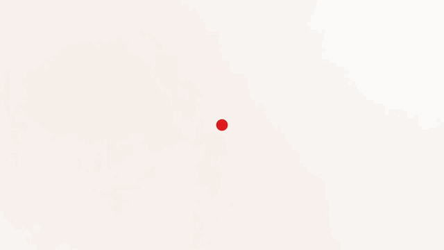
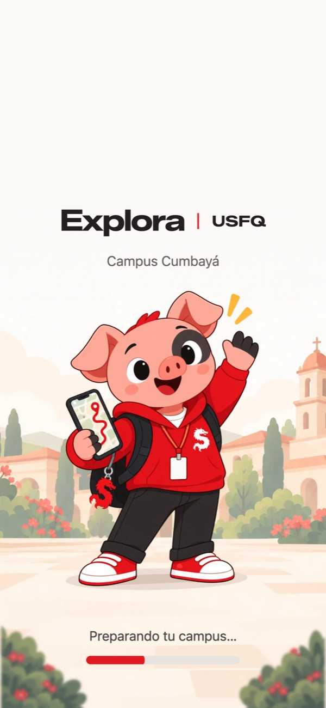
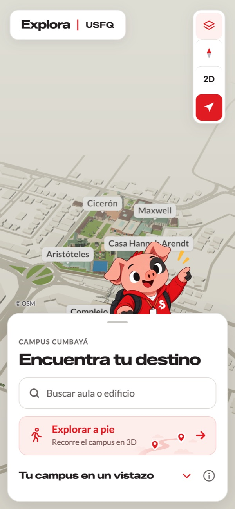
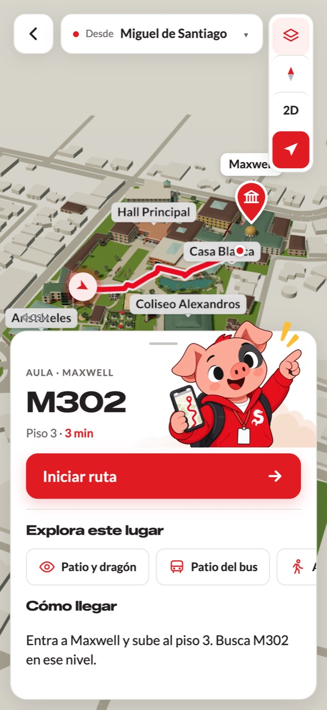
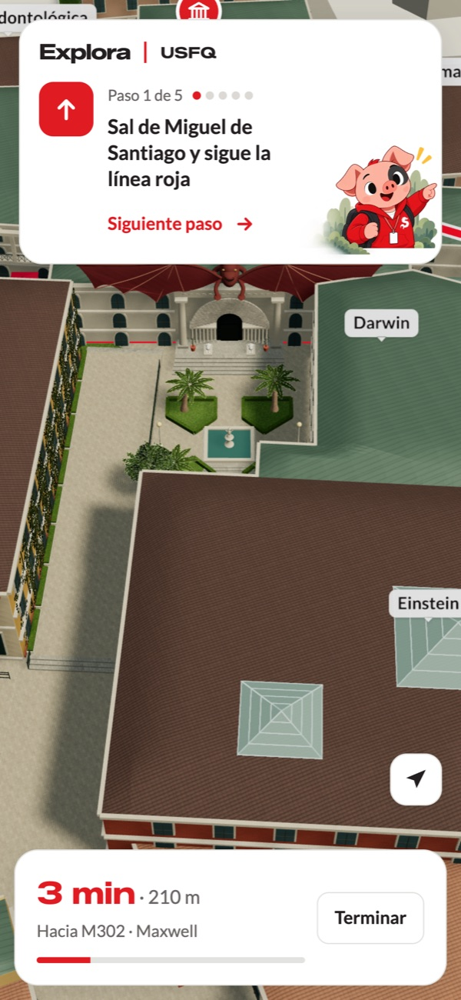
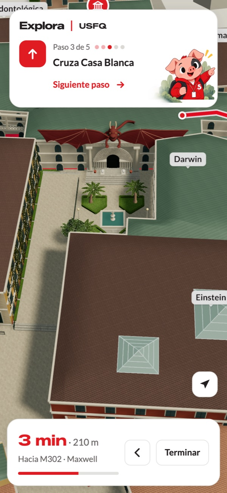
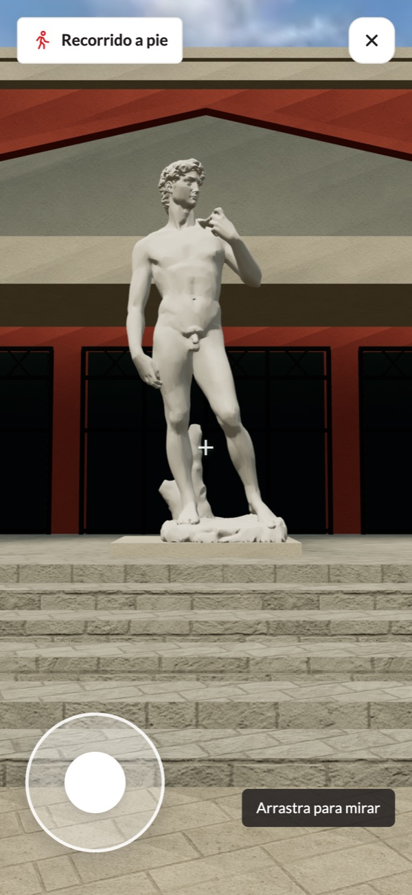

<p align="center">
  
</p>

<h1 align="center">Explora | USFQ</h1>

<p align="center">
  <strong>Un GPS 3D para encontrar cualquier aula del campus Cumbayá de la Universidad San Francisco de Quito, desde el celular.</strong>
</p>

<p align="center">
  <a href="https://usfq-campus-nav.vercel.app"></a>
</p>

<p align="center">
  <a href="https://github.com/rosvjames/USFQMap/actions/workflows/ci.yml"></a>
  
  
  
  
  
  
  <a href="LICENSE"></a>
</p>

<p align="center">
  <a href="docs/media/explora-promo.mp4">
    
  </a>
  <br />
  <sub>▶ <a href="docs/media/explora-promo.mp4">Ver el video promocional completo con sonido</a> · hecho 100 % en código con la escena 3D real de la app</sub>
</p>

<details>
<summary><b>🇬🇧 In English</b></summary>

<br />

**Explora | USFQ** is a mobile-first 3D campus navigator for Universidad San Francisco de Quito (Ecuador). Classrooms are identified by codes like **M302**, which don't tell newcomers where the building is. You type a room code or a place, see it on a 3D model of the campus, and get step-by-step walking directions with your phone's GPS.

- **Stack:** React 19, React Three Fiber / Three.js, TypeScript (strict), Vite, Vitest, deployed on Vercel.
- **Map data:** building footprints and walkways from OpenStreetMap, fetched by a reproducible script and projected to a local metric grid.
- **Routing:** shortest path over a walkway graph, with on-site verified entrances and indoor shortcuts. Tests check that no route crosses a building.
- **3D:** dozens of hand-modeled landmarks built from photos, a first-person walk mode with collisions, and animated campus animals.
- **Mobile performance:** lightweight models and textures, instancing, static geometry batched by material, on-demand shadows and adaptive resolution.
- **Quality:** 282 tests across 48 files, run on every push by GitHub Actions.
- **Launch video:** fully code-animated (HTML scenes captured frame by frame with headless Chrome, sub-frame motion blur) using the app's real 3D scene.

Built by two students in October 2026 and presented at the university's open house with a QR code. [Try it live →](https://usfq-campus-nav.vercel.app)

</details>

---

## El problema

En la USFQ un aula se identifica con un código como **M302**, pero el código no dice dónde queda Maxwell ni cómo llegar. Los estudiantes nuevos y las visitas de la casa abierta se pierden entre más de 30 edificios, puentes y desniveles, y no existe un mapa interactivo del campus.

**Explora** resuelve eso: escribes el código del aula o el nombre de un lugar, ves el edificio en un modelo 3D del campus y la app te lleva paso a paso, con el GPS del celular. Se presentó en la casa abierta de la universidad el 25 de octubre de 2026, con un código QR en el stand.

## La app en el celular

<table>
  <tr>
    <td align="center" width="33%"><br /><sub><b>Carga</b><br />Gastón, la mascota, recibe al usuario</sub></td>
    <td align="center" width="33%"><br /><sub><b>Inicio</b><br />Campus 3D y búsqueda de aulas o edificios</sub></td>
    <td align="center" width="33%"><br /><sub><b>Destino</b><br />Ruta, piso y tiempo a pie hasta M302</sub></td>
  </tr>
  <tr>
    <td align="center"><br /><sub><b>Navegación</b><br />Indicaciones paso a paso con progreso</sub></td>
    <td align="center"><br /><sub><b>Detalle 3D</b><br />Patio de Maxwell y su dragón, modelados a partir de fotos</sub></td>
    <td align="center"><br /><sub><b>Explorar a pie</b><br />Recorrido en primera persona con joystick</sub></td>
  </tr>
</table>

## Qué hace

- **Busca aulas, edificios y servicios.** Entiende códigos como `M302`, `G111` o `DW010`, nombres como «Maxwell 312» y servicios como «Registro» o «Gimnasio».
- **Traza la ruta a pie** sobre la red de senderos del campus, hasta la puerta del edificio. Muestra el piso, el tiempo y la distancia.
- **Guía paso a paso** con indicaciones cortas («Cruza el Hall Principal», «Cruza el puente peatonal hacia Hayek») y el GPS del celular.
- **Muestra el lugar antes de ir.** Cada edificio tiene vistas 3D de su entrada, su patio o su detalle más reconocible.
- **Permite recorrer el campus en primera persona**, con colisiones contra edificios, agua y rejas. En el camino aparecen Gastón y los galgos Pancho y Pancha, que se pueden acariciar.
- **Funciona desde un QR.** Abre en el navegador del celular, sin instalar nada, y guarda en caché los modelos para no volver a descargarlos con la red congestionada del campus.

## Cómo está hecho

| Parte | Detalle |
|---|---|
| **Mapa del campus** | Huellas de edificios, senderos, calles y lagunas de OpenStreetMap, descargadas con un script reproducible (`npm run data`) y convertidas a un sistema local en metros. |
| **Modelo 3D** | React Three Fiber sobre Three.js. Decenas de componentes modelan a mano entradas, plazas, puentes, desniveles y esculturas a partir de fotografías tomadas por el equipo. El David del Hall Principal es un escaneo 3D real (CC BY-SA). |
| **Rutas** | Camino más corto sobre un grafo de senderos, con entradas confirmadas en sitio y pasos interiores (atravesar el Hall o Casa Blanca). Ninguna ruta atraviesa un edificio: lo comprueban las pruebas. |
| **Búsqueda** | Analiza los códigos de aula (edificio + piso + número) y avisa cuando un aula solo se puede ubicar por edificio y piso. |
| **Rendimiento en celular** | Modelos y texturas livianos para móvil, geometría instanciada, decoración estática agrupada por material, sombras que solo se recalculan cuando cambia la escena y resolución adaptada a la pantalla. |
| **Interfaz** | Diseñada para celular primero: paneles deslizables, gestos de mapa como en Google Maps (arrastrar, pellizcar y girar con dos dedos) y nombres de edificios que no se enciman. |
| **Calidad** | 282 pruebas en 48 archivos (Vitest): búsqueda, rutas, gestos de cámara, colisiones, terreno y geometría. TypeScript estricto. |
| **Mascota y arte** | Gastón, un cerdito con sudadera de la USFQ, se diseñó con GPT Image y se exporta con scripts propios. Las miniaturas de lugares son capturas del propio campus 3D. |
| **Video promocional** | Animado por completo en código: escenas HTML capturadas cuadro a cuadro con Chrome headless, motion blur por subcuadros y la escena 3D real de la app. |

```
src/
├── components/   escena 3D, edificios modelados, interfaz (paneles, navegación, recorrido a pie)
├── lib/          búsqueda, rutas, cámara, terreno, colisiones, materiales
└── data/         catálogo de lugares, datos de OpenStreetMap y referencias
scripts/          descarga de OpenStreetMap, preparación de modelos y recursos gráficos
```

## Ejecutar localmente

```bash
npm ci
npm run dev      # servidor de desarrollo
npm test         # pruebas
npm run build    # compilación de producción
```

Para probarlo en un celular de la misma red: `npm run dev -- --host 0.0.0.0`. El GPS requiere HTTPS o localhost.

## Equipo

Hecho por dos estudiantes de la USFQ en octubre de 2026:

- **James Soto** ([@rosvjames](https://github.com/rosvjames)): idea, base de la app, búsqueda, rutas, navegación, interfaz y mascota, y video promocional.
- **Julian León** ([@jjjulianleon](https://github.com/jjjulianleon)): modelado 3D del campus, materiales y terreno, recorrido a pie, animales y estilo visual.

## Datos y créditos

- El modelo es una **aproximación visual**, no un levantamiento arquitectónico: las alturas y los detalles se estiman a partir de fotografías. Los interiores aún no están en la navegación porque no hay planos oficiales. Las fuentes y los límites de cada parte están documentados en [docs/DETALLES-TECNICOS.md](docs/DETALLES-TECNICOS.md).
- Huellas y senderos: © colaboradores de [OpenStreetMap](https://www.openstreetmap.org/copyright), licencia ODbL.
- Modelo del David: Scan the World @ MyMiniFactory, [CC BY-SA 4.0](https://creativecommons.org/licenses/by-sa/4.0/). Detalles en [docs/DETALLES-TECNICOS.md](docs/DETALLES-TECNICOS.md#modelo-3d-del-david).
- Música del video: «Turn This Up a Little Louder!» de Michael Ramir C. ([Mixkit](https://mixkit.co)).
- Proyecto estudiantil, no es una aplicación oficial de la Universidad San Francisco de Quito. El nombre y la marca USFQ pertenecen a la universidad.

## Licencia

El código fuente está bajo la [licencia MIT](LICENSE). Los datos y recursos de terceros conservan su propia licencia: OpenStreetMap (ODbL), el modelo del David (CC BY-SA 4.0), las fuentes tipográficas (SIL OFL, en `public/fonts/`) y la música del video.
